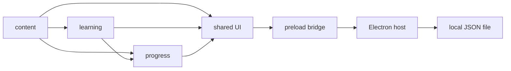

# Architecture

## Design principles

The core learning experience works without connectivity. Keep the game-domain logic deterministic and isolated from Electron and the DOM, so another platform host can reuse it. Avoid server-side infrastructure and premature extension points.

## Capability graph

Arrows in the diagram represent data/use relationships from the lower feature to the consumer, not package imports. In code: `learning -> content`, `progress -> content + learning`, `shared -> all domain modules`; `desktopApp` uses its own host APIs and only communicates through preload IPC, not direct imports of renderer implementation.

## Data flow

1. Bundled `content` provides ten ordered worlds and readings.
2. `learning` builds a shuffled five- or three-question session and evaluates each answer.
3. `progress` calculates best scores and monotonically completed worlds.
4. `shared` renders transitions and saves the new snapshot before exposing unlocked progression.
5. In Electron, `desktopApp` loads/writes application-data JSON through the isolated preload API. The standalone browser preview uses a separate localStorage namespace and is not the production storage contract.

## Persistence and compatibility

Version 1 progress shape: `{ formatVersion: 1, completedLevelIds: string[], bestScores: Record<string, number> }`. The file lives under Electron `app.getPath('userData')`. Writes are serialized and committed by temporary-file rename. The host does not silently reset unknown or invalid save files. Changing world IDs or ordering requires a reviewed compatibility/migration specification.

The Electron host uses a restricted, standard/secure `app://bundle` protocol to serve bundled local assets rather than `file://` modules. The Electron sandbox prevents direct Node/OS access from the renderer. The preload bridge exposes only narrow persistence operations. No application feature loads untrusted remote content.

## Future extension seams

Extra question types can extend `learning` behind a reviewed spec; catalog changes stay in `content`; revision history or scheduling belongs in a future capability only when needed. A non-Electron host can implement the same two-operation progress port without moving game rules into platform code.
